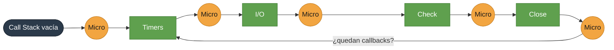

<div align="center">

<a href="https://nodejs.org/en" target="_blank"></a>

# Clase 1 de NodeJS

### Kopius · The Academy · Cohort 05 · M2

**Fundamentos, entorno de desarrollo y el Event Loop**


</div>

---

## CONTENIDO

1. [Preguntas comunes sobre Node](#1-preguntas-comunes-sobre-node)
   - [¿Qué es Node?](#qué-es-node)
   - [¿Qué lo hace tan especial?](#qué-lo-hace-tan-especial)
   - [¿Qué es Non-Blocking I/O?](#qué-es-non-blocking-io)
   - [NPM vs. NPX](#npm-vs-npx)
2. [Instalaciones y entorno de desarrollo](#2-instalaciones-y-entorno-de-desarrollo)
   - [Instalaciones requeridas](#instalaciones-requeridas)
   - [Instalaciones opcionales: NVM](#instalaciones-opcionales-nvm)
3. [Primeros pasos con Node](#3-primeros-pasos-con-node)
4. [Leer y escribir archivos (FileSystem)](#4-leer-y-escribir-archivos-filesystem)
5. [Orden de ejecución y Event Loop](#5-orden-de-ejecución-y-event-loop)
   - [El runtime de Node](#el-runtime-de-node)
   - [Libuv](#libuv)
   - [¿Qué es el Event Loop?](#qué-es-el-event-loop)
   - [Las seis colas](#las-seis-colas)
   - [¿Cómo funciona el Event Loop?](#cómo-funciona-el-event-loop)
   - [Preguntas frecuentes](#preguntas-frecuentes)
6. [Referencias](#referencias)

---

## 1. Preguntas comunes sobre Node

### ¿Qué es Node?

> [!NOTE]
> Node es un **entorno de ejecución** (_runtime environment_) para ejecutar ECMAScript **fuera del navegador web**.

### ¿Qué lo hace tan especial?

Es de **código abierto**, está construido sobre el **motor V8 de Google Chrome** y está diseñado para realizar tareas de **entrada/salida (E/S o I/O)**, junto con el manejo de archivos en entornos cliente/servidor.

| Característica      | Descripción                                        |
| ------------------- | -------------------------------------------------- |
| **Asincronía**      | Ejecuta operaciones sin bloquear el hilo principal |
| **Módulos**         | Módulos nativos y de terceros                      |
| **NPM**             | Gestión de paquetes integrada                      |
| **Escalabilidad**   | Pensado para aplicaciones que crecen               |
| **Multiplataforma** | Funciona en Mac, Windows y Linux                   |

### ¿Qué es Non-Blocking I/O?

> [!TIP]
> **Non-Blocking:** es una característica de Node que permite ejecutar instrucciones en paralelo **sin bloquear todo el hilo**. Casi el 99% de las funciones de Node se ejecutan en modo no bloqueante, y esto lo logra gracias a la librería **libuv**.

> [!WARNING]
> **Blocking:** la ejecución del código debe esperar a que se complete el proceso y, mientras tanto, **impide que se sigan ejecutando otras instrucciones** en paralelo.

### NPM vs. NPX

|                 | NPM                                                                                        | NPX                                                                 |
| --------------- | ------------------------------------------------------------------------------------------ | ------------------------------------------------------------------- |
| **Nombre**      | Node Package Manager                                                                       | Node Package Execute                                                |
| **¿Qué hace?**  | Gestiona los paquetes de Node. Es el registro con mayor crecimiento en paquetes publicados | Ejecuta comandos de paquetes de npm **sin instalarlos globalmente** |
| **Instalación** | Viene incluido con Node                                                                    | Viene incluido con npm                                              |

📚 Referencia: [Overview of Blocking vs Non-Blocking](https://nodejs.org/learn/asynchronous-work/overview-of-blocking-vs-non-blocking)

<sub>[⬆ Volver al índice](#índice)</sub>

---

## 2. Instalaciones y entorno de desarrollo

### Instalaciones requeridas

| Herramienta                                          | Para qué la usamos       |
| ---------------------------------------------------- | ------------------------ |
| [Visual Studio Code](https://code.visualstudio.com/) | Editor de código         |
| [Postman](https://www.postman.com/downloads/)        | Probar APIs              |
| [Table Plus](https://tableplus.com/)                 | Cliente de base de datos |
| [Git](https://git-scm.com/)                          | Control de versiones     |
| [Node](https://nodejs.org/es/)                       | Runtime de ECMAScript    |
| [Google Chrome](https://www.google.com/chrome/)      | Navegador                |
| [Docker Desktop](https://www.docker.com/get-started) | Contenedores             |

**Configurar Git**

```bash
git config --global user.name "Tu nombre"
git config --global user.email "Tu correo"
```

**Descargar imágenes de Docker**

> [!NOTE]
> Es opcional, pero la vamos a necesitar más adelante.

```bash
docker pull postgres:16.15
```

### Instalaciones opcionales: NVM

**Node Version Manager** permite instalar y cambiar entre distintas versiones de Node.

<details>
<summary><b>Mac</b></summary>

```bash
curl -o- https://raw.githubusercontent.com/nvm-sh/nvm/v0.40.8/install.sh | bash
```

</details>

<details>
<summary><b>Windows</b></summary>

Descarga el instalador directamente:

```
https://github.com/coreybutler/nvm-windows/releases/download/1.2.2/nvm-setup.exe
```

O desde PowerShell:

```powershell
Invoke-WebRequest `
  -Uri "https://github.com/coreybutler/nvm-windows/releases/download/1.2.2/nvm-setup.exe" `
  -OutFile "$env:USERPROFILE\Downloads\nvm-setup.exe"
```

</details>

**Comandos útiles**

| Comando           | Para qué sirve                            |
| ----------------- | ----------------------------------------- |
| `nvm version`     | Verificar NVM                             |
| `nvm install lts` | Instalar la última versión LTS de Node.js |
| `nvm list`        | Ver las versiones instaladas              |
| `nvm use 24.11.1` | Activar una versión específica            |
| `node --version`  | Verificar Node.js                         |
| `npm --version`   | Verificar npm                             |

📚 Referencias: [nvm-sh/nvm](https://github.com/nvm-sh/nvm) · [coreybutler/nvm-windows](https://github.com/coreybutler/nvm-windows)

<sub>[⬆ Volver al índice](#índice)</sub>

---

## 3. Primeros pasos con Node

> [!IMPORTANT]
> **Tarea 001 - Primer programa**
>
> 1. Con la terminal de comandos en el directorio de trabajo, crea la carpeta `clase-01-fundamentos`.
> 2. Dentro, crea tu primer archivo `app.js`.
> 3. Usando ECMAScript, crea dos variables:
>    - `message`, inicializada con el string `'Welcome'`.
>    - `period`, inicializada con `new Date().getHours() < 12 ? "AM" : "PM";`
> 4. Escribe un saludo usando `message`: si es de mañana, asigna `Good Morning`; si es de tarde, `Good Afternoon`.
> 5. Al final, imprime en la consola el valor de `message`.

Ejecuta el programa desde la terminal:

```bash
node app
```

> [!TIP]
> Al finalizar vamos a renombrar el archivo **app.js** como **tarea001.js**, esto no va a permitir seguir creando nuevos archivos app.js para las siguientes prácticas.

<sub>[⬆ Volver al índice](#índice)</sub>

---

## 4. Leer y escribir archivos (FileSystem)

El archivo con el que vamos a trabajar se descarga desde
[este README](https://github.com/aduartekopiustech/node-fullstack-clase-01/blob/main/README.md).

```ECMAScript
const fs = require("fs");

const data = fs.readFileSync("README.md", "utf8");

console.log(data);

fs.writeFileSync("README-COPY.md", data.replace(/ECMAScript/gi, "ECMAScript"));
```

> [!IMPORTANT]
> **Tarea 002 - Lectura y analisis de archivos**
>
> 1. Crea un programa que lea el archivo `README-COPY.md`.
> 2. Cuenta cuántas palabras tiene el archivo.
> 3. Cuenta las ocurrencias de la palabra `ECMAScript`, distinguiendo mayúsculas y minúsculas (_case sensitive_).

Ejecuta el programa desde la terminal:

```bash
node app
```

<sub>[⬆ Volver al índice](#índice)</sub>

> [!TIP]
> Al finalizar vamos a renombrar el archivo **app.js** como **tarea002.js**, esto no va a permitir seguir creando nuevos archivos app.js para las siguientes prácticas.

---

## 5. Orden de ejecución y Event Loop

<p align="center">
  
</p>

> [!NOTE]
> **¿Quién se ejecuta primero?** No lo sabemos: es el **Event Loop** quien lo decide.

ECMAScript es un lenguaje **synchronous**, **blocking** y **single-threaded**, lo cual es un problema con código como este:

```ECMAScript
while (true) {
  // procedimiento
}
moreWork(); // nunca se ejecutará
```

Este es el problema que Node viene a resolver.

### El runtime de Node

<p align="center">
  
</p>

En esencia, el entorno de ejecución de Node está compuesto por tres componentes principales:

| Componente                   | Qué aporta                                                                    |
| ---------------------------- | ----------------------------------------------------------------------------- |
| **Dependencias externas**    | V8, libuv y crypto, que Node.js necesita para funcionar                       |
| **Funcionalidades de C++**   | Acceso al sistema de archivos y comunicación a través de redes                |
| **Biblioteca de ECMAScript** | Funciones y utilidades para acceder a lo implementado en C++ desde ECMAScript |

> [!TIP]
> Aunque todos son importantes, el componente fundamental para la programación asíncrona en Node.js es una dependencia externa llamada **libuv**.

### Libuv

Dentro del entorno de ejecución de Node.js, su función es **proporcionar soporte para gestionar operaciones asíncronas**.

🎬 Recurso visual: [Asynchronous Code Execution in Node.js](https://cdn.builder.io/o/assets%2FYJIGb4i01jvw0SRdL5Bt%2Fd5131502a8e84dfcab11f1c3820101b7%2Fcompressed?apiKey=YJIGb4i01jvw0SRdL5Bt&token=d5131502a8e84dfcab11f1c3820101b7&alt=media&optimized=true)

Crea otro archivo `app.js` y copia el siguiente código:

```ECMAScript
console.log("Inicio de programa");

setTimeout(() => {
  console.log("Primer Timeout");
}, 3000);

setTimeout(() => {
  console.log("Segundo Timeout");
}, 1);

setTimeout(() => {
  console.log("Tercer Timeout");
}, 0);

console.log("Fin de programa");
```

- ¿Qué pasa si dos Timeouts terminan al mismo tiempo?
- ¿Qué pasa si una promesa termina al mismo tiempo que otro callback?
- ¿En qué orden se ejecutan?

> [!NOTE]
> El **Event Loop** es quien decide.

### ¿Qué es el Event Loop?

Técnicamente, el Event Loop es un programa escrito en lenguaje C. Sin embargo, puedes entenderlo como un **patrón de diseño que orquesta o coordina la ejecución de código síncrono y asíncrono** en Node.js.

El Event Loop se ejecuta continuamente mientras tu aplicación Node.js esté en funcionamiento, gestionando múltiples operaciones que se ejecutan de manera concurrente.

### Las seis colas

En cada iteración del ciclo existen seis colas diferentes. Cada una contiene una o más funciones callback que eventualmente deberán ejecutarse en la pila de llamadas (_Call Stack_).

<p align="center">
  
</p>

| #   | Cola               | Contiene callbacks de                                          |
| --- | ------------------ | -------------------------------------------------------------- |
| 1   | **Timer Queue**    | `setTimeout` y `setInterval` (implementada como un _min-heap_) |
| 2   | **I/O Queue**      | Operaciones asíncronas de módulos como `fs` y `http`           |
| 3   | **Check Queue**    | `setImmediate` (específica de Node.js)                         |
| 4   | **Close Queue**    | Eventos de cierre de una operación asíncrona                   |
| 5   | **nextTick Queue** | `process.nextTick` _(microtarea)_                              |
| 6   | **Promise Queue**  | Promesas nativas de ECMAScript _(microtarea)_                  |

> [!NOTE]
> Las colas 5 y 6 forman la **Microtask Queue**.

### ¿Cómo funciona el Event Loop?

> [!IMPORTANT]
> Todo el código ECMAScript **síncrono** tiene prioridad sobre el asíncrono. El Event Loop solo empieza a ejecutar callbacks cuando la **Call Stack está vacía**.



🟩 Fases del Event Loop · 🟧 Microtareas (primero `nextTick`, después Promesas)

Orden de prioridad paso a paso:

1. 🟧 **Microtareas:** primero la cola `nextTick` y después la de Promesas.
2. 🟩 **Timers Phase:** callbacks de temporizadores cuyo tiempo de espera ya finalizó.
3. 🟧 **Microtareas** después de cada callback de la cola de temporizadores.
4. 🟩 **I/O Phase:** callbacks de entrada/salida.
5. 🟧 **Microtareas** pendientes.
6. 🟩 **Check Phase:** callbacks de `setImmediate`.
7. 🟧 **Microtareas** después de cada callback de la cola de verificación.
8. 🟩 **Close Callbacks Phase:** callbacks de la cola de cierre.
9. 🟧 **Microtareas** por última vez dentro de la misma iteración.

> [!TIP]
>
> - Si todavía quedan callbacks por procesar, el Event Loop sigue activo en una **nueva iteración** y repite los mismos pasos.
> - Si no queda código ni ninguna operación activa que mantenga el proceso en funcionamiento, el **Event Loop finaliza**.

### Preguntas frecuentes

Algunas preguntas que se pueden responder después de entender cómo funciona el Event Loop:

<details>
<summary><b>¿Cuando una tarea asíncrona finaliza en libuv, en qué momento Node.js decide ejecutar su callback en la Call Stack?</b></summary>

> Las funciones callback se ejecutan **únicamente cuando la Call Stack está vacía**.

</details>

<details>
<summary><b>¿Node.js espera a que la Call Stack esté vacía antes de ejecutar un callback o interrumpe el flujo normal de ejecución?</b></summary>

> El flujo normal de ejecución **no se interrumpe** para ejecutar una función callback.

</details>

<details>
<summary><b>¿Qué sucede con setTimeout y setInterval, que también retrasan la ejecución de un callback?</b></summary>

> Los callbacks de `setTimeout` y `setInterval` reciben **la primera prioridad**.

</details>

<details>
<summary><b>Si setTimeout y readFile finalizan al mismo tiempo, ¿cuál se ejecuta primero en la Call Stack?</b></summary>

> Los callbacks de los temporizadores se ejecutan **antes** que los de entrada/salida (I/O), incluso si ambos están listos exactamente al mismo tiempo.

</details>

<sub>[⬆ Volver al índice](#índice)</sub>

---

## Referencias

- 📘 [Overview of Blocking vs Non-Blocking](https://nodejs.org/learn/asynchronous-work/overview-of-blocking-vs-non-blocking)
- 📘 [The Node.js Event Loop, Timers and process.nextTick()](https://nodejs.org/learn/asynchronous-work/event-loop-timers-and-nexttick)
- 📗 [A Visual Guide to the Node.js Event Loop](https://www.builder.io/blog/visual-guide-to-nodejs-event-loop)
- 🛠️ [nvm-sh/nvm](https://github.com/nvm-sh/nvm) · [coreybutler/nvm-windows](https://github.com/coreybutler/nvm-windows)

## Mentor

**Ariel Duarte** · Kopius · The Academy

<sub>[⬆ Volver al índice](#índice)</sub>
